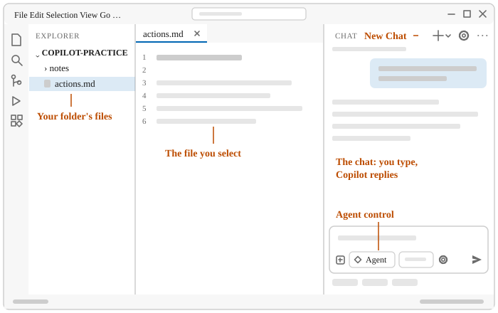
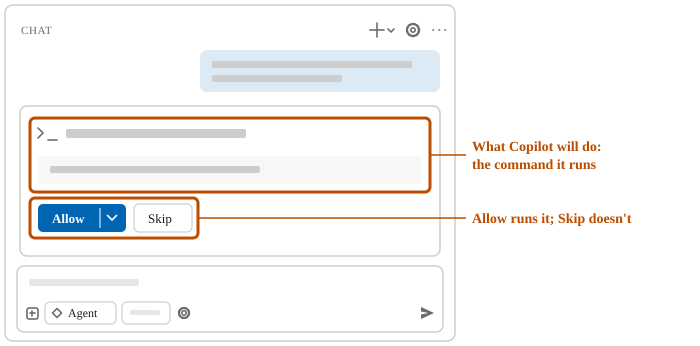
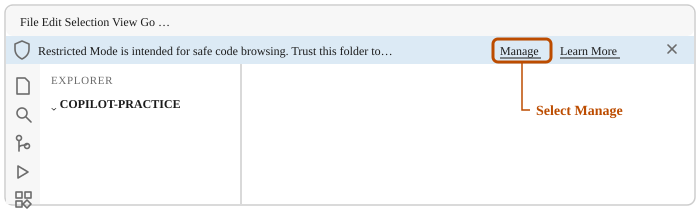

# Make your first request to Copilot

In this unit, you open the chat in VS Code, have GitHub Copilot create a folder to practice in, and
open that folder.

## 1. Open VS Code and the chat

You type your requests to Copilot in the chat.

1. Press the Windows key, type `code`, and press Enter.
2. On the **View** menu, select **Chat**.

   

   The drawing shows VS Code later in this training, with files in the folder. Gray bars stand for text that differs on your screen. **New Chat** starts a fresh chat.

Check: the chat is open, and a control at the bottom of the chat box says **Agent**.

<!-- more: If the control doesn't say Agent, or the chat won't open -->
With **Agent** selected, Copilot can run commands and create files, not only answer questions. In a
narrow chat, the controls may show only icons.

If no control says **Agent**, select the chat box, hold down Ctrl, and press the period key (.).
The list of agents opens, with the selected agent highlighted. Select **Agent**. Leave the other
controls as they are.

If VS Code doesn't open, no chat appears, or the chat asks you to sign in, see
[Getting set up](../troubleshooting.md#getting-set-up).
<!-- /more -->

## 2. Have Copilot create a practice folder

Your first request: Copilot makes the folder you practice in.

1. In the chat box, enter:

   > Create a new, empty folder named copilot-practice.
   > Put it in the folder Windows uses as my Documents folder, which may be under OneDrive.
   > Change nothing else on my computer.

2. If a permission request appears, allow it if it looks for your Documents folder or creates
   `copilot-practice` there. If it doesn't, select **Skip**. Skip doesn't run the command; Copilot
   carries on without it. When it asks, it waits for you.

   

3. In Windows File Explorer, select **Documents** on the left.

Check: Documents has a `copilot-practice` folder, and it's empty.

<!-- more: When Copilot asks before it acts -->
By default, Copilot creates and edits files in your open folder without asking. It asks first for
a few settings files, and for files outside the folder. It also asks before it runs a command that
could change your computer.
<!-- /more -->

<!-- more: If you can't find the folder -->
If Documents has no copilot-practice folder, tell Copilot:

> I don't see copilot-practice in Documents in File Explorer.
> Tell me where you created it.
> Create it in the Documents folder File Explorer shows, and remove the other one.
> Change nothing else.
<!-- /more -->

## 3. Open the practice folder in VS Code

Copilot works on the files in the folder you open.

1. On the **File** menu, select **Open Folder**.
2. In Documents, select `copilot-practice`, and then **Select Folder**.
3. On the Restricted Mode bar, under the menu bar, select **Manage**. On the **Workspace Trust** page that opens, select **Trust**. If VS Code asks instead whether you trust the authors, leave the box about the parent folder
   unticked and select **Yes, I trust the authors**.

   

Check: the list on the left shows `COPILOT-PRACTICE`, with nothing in it yet.

<!-- more: If the chat or file list looks different -->
VS Code reopens with the folder, and the chat starts empty. If the control at the bottom of the
chat box doesn't say **Agent**, select the chat box. Hold down Ctrl, and press the period key (.).
The list of agents opens, with the selected agent highlighted. Select **Agent**.

If the list on the left is missing, on the **View** menu, select **Explorer**.
<!-- /more -->

## What you did

You opened the chat, had Copilot create a practice folder, checked it in File Explorer, and opened
it in VS Code.
