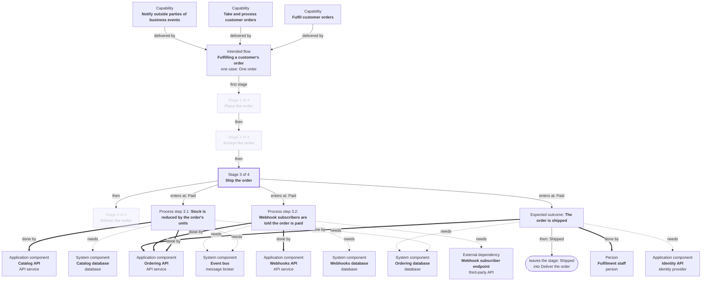

# Fulfilling a customer's order: stage 3 of 4, Ship the order

**How to read it.** Solid arrows between process steps follow the case: each is labelled with the state the case is in when the next process step starts. Where several arrows leave one process step, they are alternatives: one case takes one of them. **Done by** is every part that carries the process step out; **needs** is a part it cannot complete without that does not itself carry the process step out. Process steps are numbered within their stage, the same in every stage file. Process step 3.1: Stock is reduced by the order's units; Process step 3.2: Webhook subscribers are told the order is paid: each changes no state of the case: it happens alongside, and nothing waits on it.

<!-- bfo-generated-from {"flow": "F1", "stage": "ST3", "tables": {"about": "c9f8351ce577", "agent-system": "80df4fb74aa2", "capabilities": "f4fc19936bf8", "case-attributes": "3f95e73172bd", "expectations": "cd4f9fe286e7", "failure-modes": "132f9700adac", "flows": "a27265fffff5", "lifecycle": "440f83f4a1fa", "measure-gaps": "f3ef7b5dbcfd", "measures": "3c7ec5c71e65", "participation": "f08de4c4ac9a", "remedies": "2e9c1e60a265", "sources": "328a3c147492", "stages": "4595b2c6e50a", "step-impact": "4e066d413fd0", "steps": "e09fc039d65e", "subjects": "644d8b1712b7"}} -->
