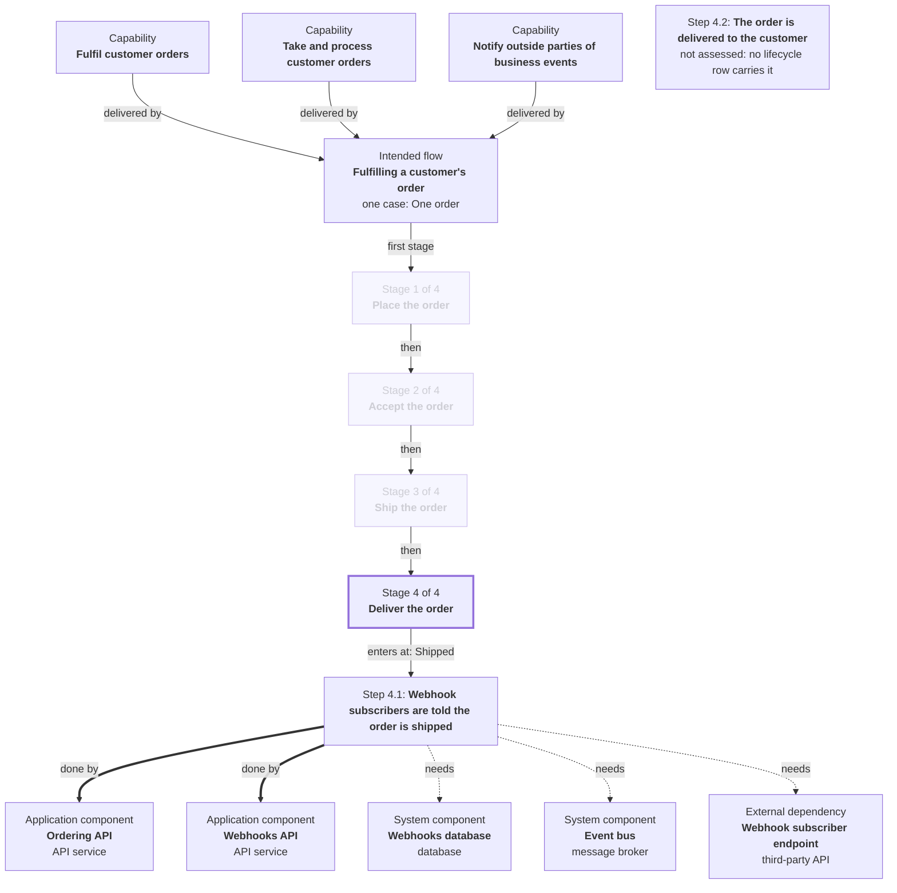

# Fulfilling a customer's order: stage 4 of 4, Deliver the order

**How to read it.** Solid arrows between steps follow the case: each is labelled with the state the case is in when the next step starts. Where several arrows leave one step, they are alternatives: one case takes one of them. **Done by** is every part that carries the step out; **needs** is a part it cannot complete without that does not itself carry the step out. Steps are numbered within their stage, the same in every stage file. Step 4.1: Webhook subscribers are told the order is shipped changes no state of the case: it happens alongside, and nothing waits on it.

